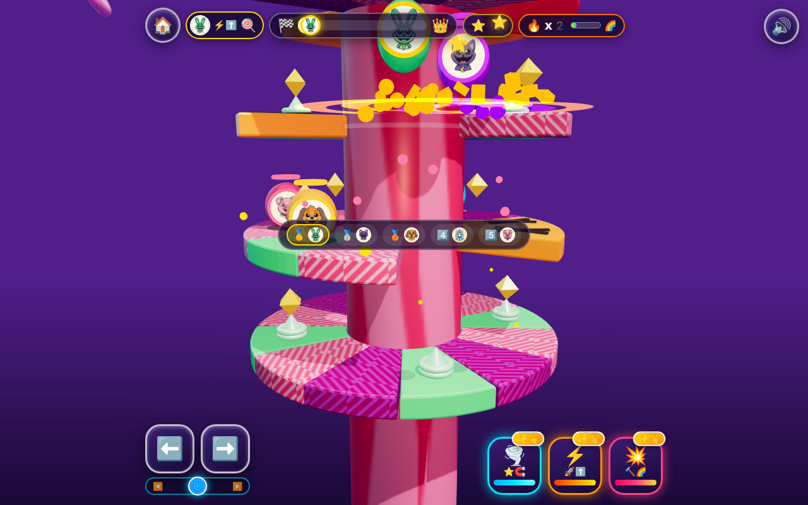

# 🏰 Critter Helix Tower 3D: Bouncy Cloud Climb! 🐾✨

**Live Game:** [https://kunruiw1991.github.io/critters-towerjump3d/](https://kunruiw1991.github.io/critters-towerjump3d/)  
**Repository:** [https://github.com/kunruiw1991/critters-towerjump3d](https://github.com/kunruiw1991/critters-towerjump3d)

A vibrant, 100% kid-friendly **3D WebGL Rotating Spiral Helix Tower Jump & Smash** race built with **Three.js** (`js/vendor/three.min.js`)! Pick your favorite Smiling Critter, rotate the giant 3D candy spiral tower, bounce off emerald spring pads, shatter cracked gold & hazard wedges with shockwave rings, trigger 3 interactive Power Pedals plus **Rainbow Fever Mode (`🌈`)**, and race 4 AI Critter rivals to the **Golden Summit Crown Podium** across 8 themed towers!

---

## 🎮 Controls (Desktop & Mobile Touch)

| Action | Desktop Keyboard / Mouse | Mobile / Tablet Touch |
| :--- | :--- | :--- |
| **Rotate 3D Helix Tower** | `⬅️` / `➡️`, `A` / `D`, or **Click & Drag** horizontally | **Swipe / Drag** on the 3D tower or `#steer-touch-track`, or hold giant `⬅️` / `➡️` buttons |
| **🌪️ Star Magnet Pedal** | `Key 1` | Tap Cyan `🌪️⭐` Pedal |
| **⚡ Rocket Leap Pedal** | `Key 2` or `Space` | Tap Orange-Gold `⚡🚀` Pedal |
| **💥 3-Ring Mega Smash** | `Key 3` or `Enter` | Tap Magenta `💥🔨` Pedal |
| **🔊 Mute / Unmute SFX** | Click top-right `🔊` / `🔇` button | Tap top-right `🔊` / `🔇` button |

---

## 🐾 8 Playable Smiling Critters & Signature Perks

Every Critter features a real high-contrast circular portrait (`icons/*.jpg`), upright camera-facing 3D billboard medallion, golden player crown halo, and an active gameplay perk:

| Critter | Icon | Dual-Icon Perk | Active 3D Gameplay Advantage |
| :--- | :---: | :---: | :--- |
| **Hoppy Hopscotch** | 🐰 | `⚡🦘` | **+7% Spring & Bounce Launch** height on every jump and spring pad |
| **DogDay** | 🐶 | `☀️🧲` | **Wider Passive Star Magnet** pull radius (`2.35u` vs `1.55u` base) |
| **CatNap** | 🐱 | `🌙☁️` | **Moon-Float Feather Gravity** (`0.86x` descent gravity for forgiving air control) |
| **Bobby BearHug** | 🐻 | `💖🛡️` | **Heart Shield** automatically shatters the first red hazard wedge per race into a super-bounce |
| **PickyPiggy** | 🐷 | `🍎⭐` | **Snack Star Bonus** awards `+2` bonus stars every 4th star collected |
| **CraftyCorn** | 🦄 | `🌈🎨` | **Extended Rainbow Fever** duration (`5.4s` vs `4.2s` standard) |
| **KickinChicken** | 🐔 | `🔥👟` | **+32% Faster Pedal Recharge** rate for `🌪️`, `⚡`, and `💥` pedals |
| **Bubba Bubbaphant** | 🐘 | `💡🧭` | **3D Cyan Beacon Ring** highlights the next overhead spring pad on the spiral |

---

## 🏰 8 Distinct 3D Candy Helix Towers (Stages 1–8)

| Stage | Tower Theme | Rings | Spiral Geometry & Stage Modifier | Difficulty Calibration |
| :---: | :--- | :---: | :--- | :--- |
| **1** | 🍭 **Lollipop Swirl** | `16` | Wide 3-slice gaps, diagonal candy stripes, `+1` bonus star on every spring bounce | Forgiving 3-star (`🥇`) intro with late-tower AI speed taper |
| **2** | ☁️ **Fluffy Cloud** | `18` | Polka-dot sky pillar, `+10%` extra cushion bounce on normal cloud slices | Gentle pack racing |
| **3** | 🍓 **Berry Frosting** | `20` | Tight 1-step spiral, `3⭐` star bursts when shattering cracked gold slices | Intermediate spring-seeking AI |
| **4** | 🍋 **Lemon Fizzy** | `22` | 3-step spiral twist, `+25%` faster Power Pedal recharge across the stage | Fast-paced power-pedal climbing |
| **5** | 🍇 **Grape Jelly** | `24` | Wide 3-slice gaps, `+6%` jelly rebound on normal slices |Mid-high hazard density |
| **6** | 🍉 **Watermelon Bounce** | `26` | Seed-patterned pillar, `+8%` super-spring launch boost | High-altitude spring chains |
| **7** | 🧊 **Crystal Ice** | `28` | Glossy low-friction ice rotational momentum when steering | Precision drift & hazard dodging |
| **8** | 🌈 **Rainbow Crown** | `30` | 6-color rainbow rings, early **Rainbow Fever** trigger at `x5` combo | Championship finale |

---

## 🏆 Strict 5-Critter Podium & Top-3 Qualification Rules

All 5 racers (**Player + 4 AI Rivals**) climb and bounce simultaneously on the 3D tower and celebrate on the **Golden Summit Crown Platform**:

- **🥇 1st Place (`3⭐` — `👑⭐⭐⭐`)**: Unlocks the next tower stage + Gold Podium Pillar!
- **🥈 2nd Place (`2⭐` — `🎉⭐⭐`)**: Unlocks the next tower stage + Silver Podium Pillar!
- **🥉 3rd Place (`1⭐` — `✨⭐`)**: Unlocks the next tower stage + Bronze Podium Pillar!
- **4️⃣ 4th & 5️⃣ 5th Place (`0⭐` — `😢☁️` Sad Defeat)**: Does **NOT** unlock the next stage, plays the pitch-sliding sad trombone (`defeatTrombone`), hides the Next Stage (`⏭️`) button, and pulses the Retry (`🔄`) button.

---

## 🛠️ Technical Architecture

- **3D WebGL Engine (`Three.js r161`)**: `PCFSoftShadowMap` real-time directional shadows, `ACESFilmicToneMapping`, procedural `PMREMGenerator` studio environment reflections, custom extruded 3D wedge slices (`ExtrudeGeometry`), 3D helical spring coils, 3D hazard spikes, and attached 3D power-up meshes (`magnetAuraGroup`, `rocketFlameGroup`, `smashShellMesh`).
- **120Hz Substepped Physics & Critically-Damped Follow Cam**: Swept vertical collision detection prevents tunneling at high rocket velocities, paired with a landing-floor-tracked spring camera (`omega = 6.2`) and directional trauma shake.
- **Zero-GC Object Pooling**: Pre-allocated pools for 3D burst particles (`particlePool`), 3D wedge shatter fragments (`debrisPool`), additive 3D shockwave rings (`shockwavePool`), and 3D-to-HUD screen-projected flying star coins (`flyingCoinPool`).
- **Sample-Accurate Web Audio Synthesizer (`SoundFX`)**: Click-free `0.008s` linear attack envelopes scheduled via `AudioContext.currentTime + delaySec` for bounce, spring, smash, hazard, star chimes, per-pedal power effects, Rainbow Fever chimes, victory fanfare, and sad trombone glissando.
